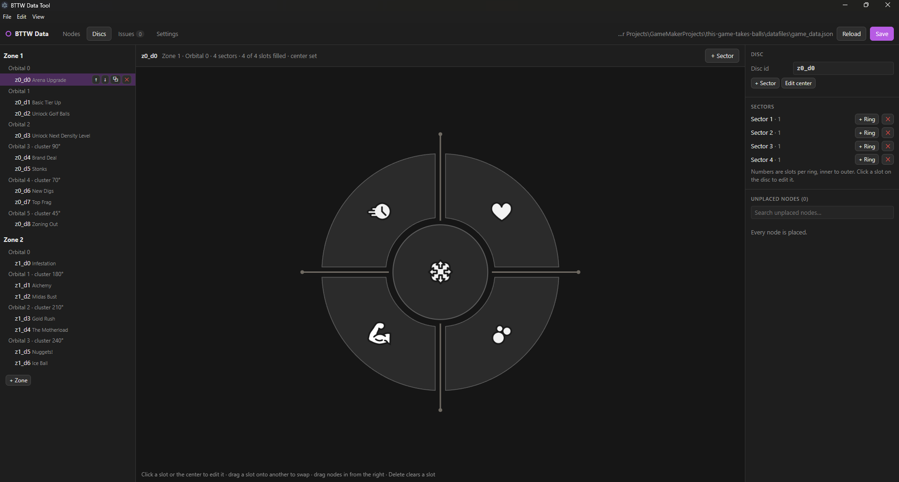

# BTTW Data Tool

A desktop editor (Electron) for the upgrade data in Balls to the Walls, a commercial game I'm making in GameMaker. The game's repo is private. This repo holds only the tool; the GML that loads its output lives in the game project.

## Why I built it

Adding or rebalancing an upgrade used to mean editing several places by hand: `upgr.csv`, the `scr_init_nodes` script, and a separate JSON file for each disc. Laying nodes out on the skill tree was tedious and easy to get wrong. I built this tool in October 2026 to put all of that in one file with a visual editor.

## What it does

- Keeps every upgrade node and the full disc layout in one file, `game_data.json`.
- **Nodes** tab: a table with one row per upgrade, edited in place.
- **Discs** tab: a visual editor for the skill-tree discs. Drag nodes onto slots, drag one slot onto another to swap them, and give any disc any number of sectors, rings and slots.
- **Issues** tab: lists unplaced nodes, empty slots, missing sprites, unknown stats, duplicates and deleted save keys. Click one to jump to it.
- Undo and redo for every change.
- Generates a GML script (`scr_game_data.gml`) in the game project on each save, so the data is compiled into the game and no readable data file ships with it.
- Live reload: with GMLive, the running game picks up each save without losing progress.

## How I verified the migration

- `game_data_compare_legacy()`, a GML function in the game's loader script, runs the old init scripts and the new loader inside the game and lists every difference between the two results.
- `npm test` runs the import against the game project again. It checks that the new `op` + `value` fields convert back to the original five modifier columns exactly for every row of `upgr.csv`, and that saving and reloading `game_data.json` gives identical output.
- Every save keeps the previous file as `game_data.json.bak`.

`npm test` reads from the game's project folder, which is private, so it can't be run from this repo alone.

## User guide

Setup, hooking the tool up to the game, and how each tab works: [docs/user-guide.md](docs/user-guide.md).
